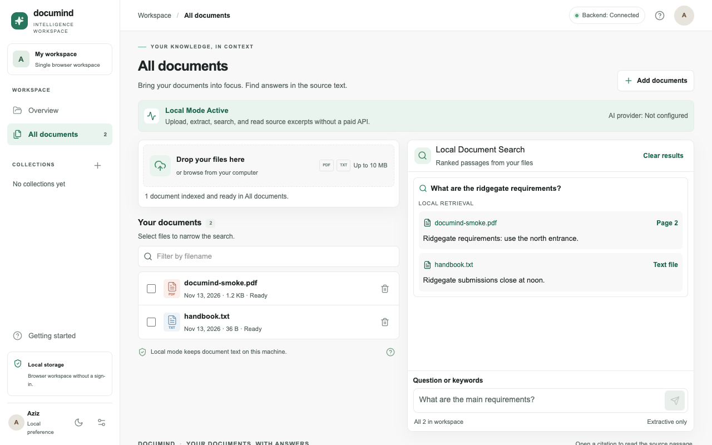

# DocuMind — AI Document Intelligence Workspace

DocuMind is a local dashboard for uploading PDFs and text files, finding relevant passages, and organizing documents into collections. **No API key or paid service is needed.** The application does not include sign-in and is intended for use on your own machine.



*Local mode running with generated example documents. DocuMind is available as source and has no public hosted demo.*

The first public release is a reviewed snapshot of an MVP developed before the showcase opened. The showcase history starts at that snapshot; its commits do not represent the original development timeline.

## How it works

- **Interface:** Next.js, React, and TypeScript.
- **Backend:** FastAPI and Python. PyMuPDF extracts PDF text with page references.
- **Local search:** SQLite FTS5 and BM25 rank verbatim passages.
- **Optional provider:** OpenAI can generate an answer from retrieved passages when explicitly selected.
- **Runtime:** Docker Compose or separate local backend and frontend processes.

See the [architecture and API](ARCHITECTURE.md), the [14-day improvement roadmap](docs/roadmap.md), and the [release workflow](docs/release-workflow.md).


## Start with Docker

Requires Docker with Compose v2. From the project directory:

```sh
docker compose up --build
```

Open [DocuMind on localhost:3003](http://localhost:3003). The API is at [localhost:8001](http://localhost:8001/api/health). Both published ports are bound to loopback. SQLite is stored in the named `documind-data` volume; `docker compose down` preserves it, and `docker compose down -v` permanently removes it. An environment file is optional.

## Start without Docker

Use Python 3.12 or later with SQLite FTS5 enabled and Node.js 24.

```sh
cd backend
python3.12 -m venv .venv
. .venv/bin/activate
pip install -r requirements.lock
uvicorn app.main:app --host 127.0.0.1 --port 8001
```

In a separate terminal:

```sh
cd frontend
npm ci
npm run dev -- --hostname 127.0.0.1
```

Visit `http://localhost:3003` as written. If changing the frontend origin, configure the backend's exact `ALLOWED_ORIGINS` allowlist. `NEXT_PUBLIC_API_URL` defaults to `http://localhost:8001`.

## Upload, search, and organize

1. Click **Add documents** or drop a text-based PDF or UTF-8 TXT file on the upload card. The dashboard reports which file is being uploaded and indexed. Ready documents appear under **All documents**.
2. Enter keywords or a question in **Local Document Search**. A question like “What are the main encryption requirements?” uses meaningful terms from the question. SQLite FTS5 ranks matching passages with BM25. You can select documents or open a collection to narrow the search. The filename filter only filters the list.
3. Read the ranked excerpts. Each source shows its filename and, for PDFs, the original page number. Open a citation to jump to its exact passage in the extracted text. If nothing matches, try a more distinctive term or widen the search scope.
4. Click the plus beside **Collections** to create one. Open a document and use its **Collection** selector to assign, move, or unfile it. Open a collection from the sidebar to browse, search, rename, or delete it once empty. Each document belongs to at most one collection.
5. Use **Settings** to change the default name, Aziz, and the moon/sun button to change the theme. Both are saved in this browser. Use a document's trash button to remove its extracted text and index entries.

Local search returns verbatim excerpts. It does not generate summaries, infer answers, or remember earlier questions as context. Retrieval uses English stemming and removes common question words, so synonyms, broad requests, and other languages can have uneven results. Scanned PDFs need OCR before upload, and complex PDF layouts may extract out of order. The viewer shows extracted passages, which may overlap; original files are not stored. Older uploads may have unknown file sizes. Default retention is seven days, enforced when documents or collections are listed or a new document is uploaded; there is no background scheduler.

## Optional OpenAI mode

Copy `backend/.env.example` to `backend/.env`, set `OPENAI_API_KEY`, and restart the backend. **Use OpenAI** then appears in the search panel. Selecting it sends a question and retrieved excerpts to OpenAI and can incur charges. Uploads and local searches never call a provider, even when a key exists. New uploads use local indexing; previously stored vectors can still participate in optional provider retrieval. No Gemini integration is included.

The backend connection indicator is separate from provider status. A configured key starts as **Unverified**. A successful completion makes the provider **Ready**; a failed provider request changes it to **Error**. This reflects the last attempted completion in the current backend process and avoids paid background checks. Switch off **Use OpenAI** to continue with local search.

| Backend setting | Default |
|---|---|
| `OPENAI_CHAT_MODEL` / `OPENAI_EMBEDDING_MODEL` | `gpt-4o-mini` / `text-embedding-3-small` |
| `ALLOWED_ORIGINS` | `http://localhost:3003` |
| `DATA_DIR` | `./data` |
| `MAX_UPLOAD_BYTES` / `MAX_REQUEST_BYTES` | 10 MiB / 12 MiB |
| `MAX_DOCUMENTS_PER_SESSION` | 20 |
| `SESSION_TTL_DAYS` | 7 |
| `MAX_QUESTION_CHARS` | 2,000 |

Keep keys on the backend. Never put them in a `NEXT_PUBLIC_*` variable. Uploaded PDFs are limited to 500 pages and extracted text to 2 million characters per file. The upload UI caps files at 10 MiB.

## Tests and manual verification

```sh
(cd backend && pytest -q)
(cd frontend && npm ci && npm run typecheck && npm run lint && npm run build)
docker compose config --quiet
```

With no key configured, verify **Backend: Connected**, **Local Mode Active**, and **AI provider: Not configured**. Upload a PDF and TXT with a distinctive term. Search for the term, open the source, and confirm the excerpt and PDF page. Create and rename a collection, assign a document, and confirm that the collection limits search. Move the document out before deleting the collection. Delete the document and confirm its term no longer returns a match. At phone width, open the sidebar with the menu button, then try uploading and searching again.

## Privacy and hosting

Local mode stores extracted text and search data in the backend SQLite file. Workspace UUIDs scope reads and mutations but are browser convenience keys, not credentials. CORS is restricted to configured origins and does not provide authentication. Request and upload limits apply, and provider exception details are kept out of responses. Treat the database, volumes, and backups as sensitive. Delete workflows remove app records and index entries; they do not guarantee forensic erasure from storage.

Do not expose this app publicly as-is. Public multi-user hosting needs authenticated sessions, server-side authorization and tenant isolation, rate limits and usage budgets, private storage, TLS, and a sandbox for untrusted file parsing. The current SQLite setup assumes one durable backend instance. See [Architecture](ARCHITECTURE.md) for the API and data flow.

See [third-party software and licenses](docs/third-party.md) for upstream terms.
